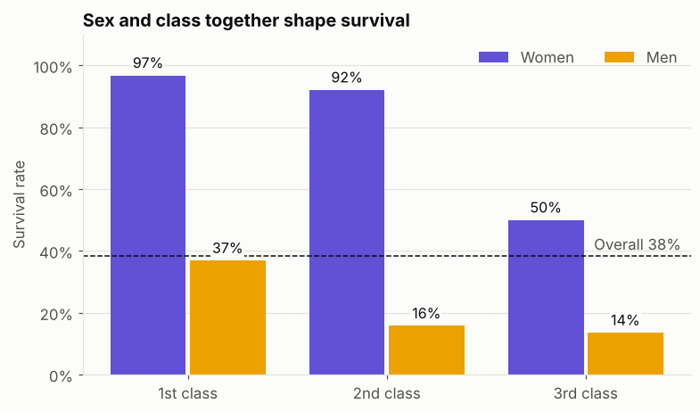
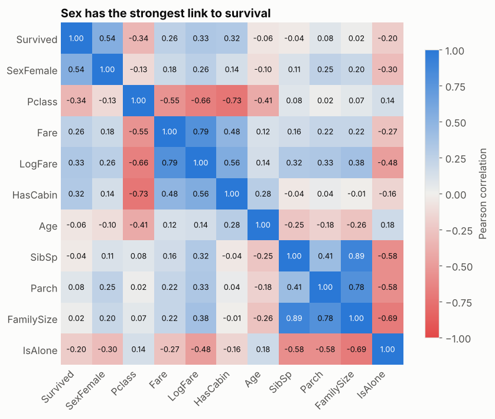

# Machine Learning Portfolio

Hands-on machine learning projects in Python, from data analysis and classic algorithms to neural networks.

**Tech stack:** Python · NumPy · pandas · Matplotlib · Jupyter

## 30 Days of Machine Learning

Following Alex Xu's 30-day ML challenge: https://github.com/AlexZXu/data-science-learning

| Day | Topic | Project |
|---|---|---|
| 1 | NumPy, pandas, Matplotlib | [Titanic feature analysis](day-01-titanic/) |

---

## Day 1: Titanic feature analysis

**Problem.** Before training any model, find which passenger features relate to survival, and set a baseline score that a model has to beat.

**Dataset.** Kaggle Titanic training set (`train.csv`): 891 passengers, with `Survived` as the target.

**Approach.**
1. [`titanic1.ipynb`](day-01-titanic/titanic1.ipynb): NumPy and pandas. Missing-value audit, survival rates by sex and class, group-wise median age imputation, and new features (`FamilySize`, `IsAlone`, `LogFare`, `HasCabin`, `Title`). Saves `titanic_clean.csv`.
2. [`titanic2.ipynb`](day-01-titanic/titanic2.ipynb): Matplotlib. Grouped bar charts, age histograms, box plots, a correlation heatmap, and a rule-based baseline with no ML.

**Key insights.**
- Women in 1st and 2nd class survived at over 90%; third-class women at 50%; men in 2nd and 3rd class near 15%.
- `SexFemale` (0.54), `Pclass` (-0.34), `LogFare` (0.33) and `HasCabin` (0.32) have the strongest correlation with survival.
- Children under 10 are the one age group well above the overall survival rate, so age's link to survival is not linear.

**Results (baseline accuracy, no ML).**

| Rule | Accuracy |
|---|---|
| Everyone dies | 61.6% |
| All women survive | 78.7% |
| Women + boys in 1st/2nd class survive | 80.0% |

These scores are measured on the same data used to find the patterns, so they are optimistic. Real evaluation needs held-out data, which arrives with cross-validation later in the challenge. 80.0% is the number to beat.
